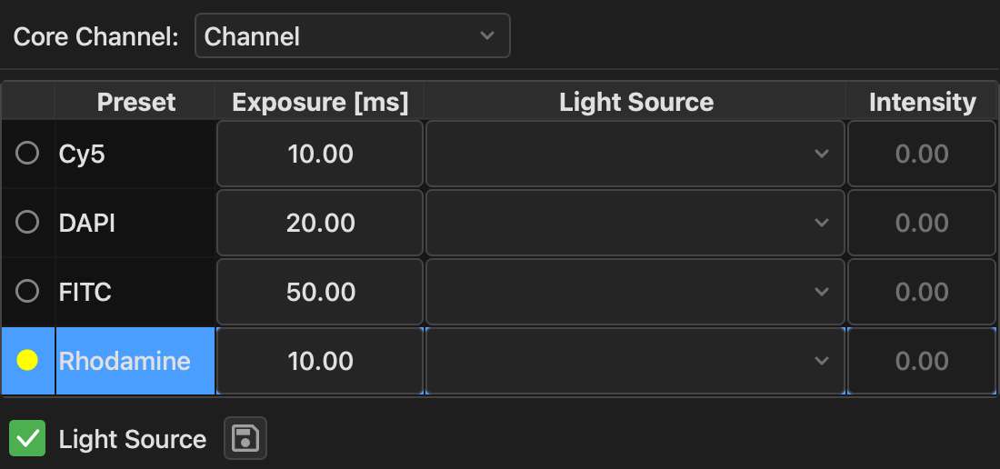
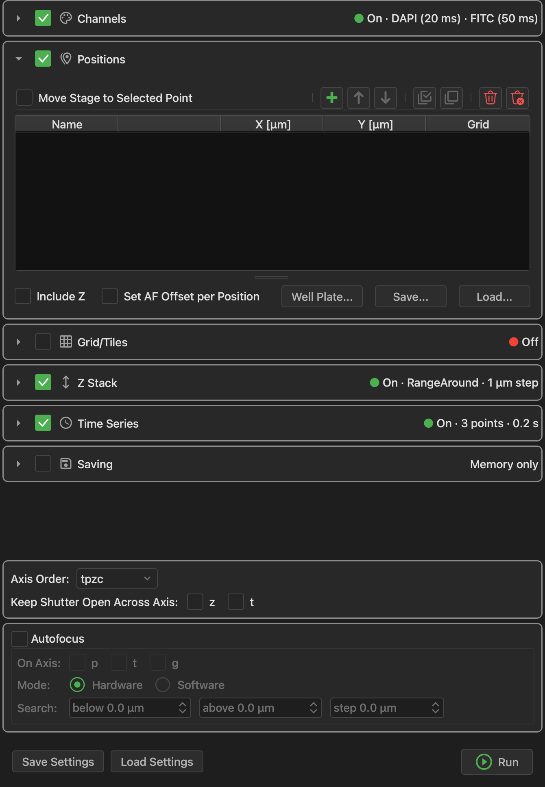
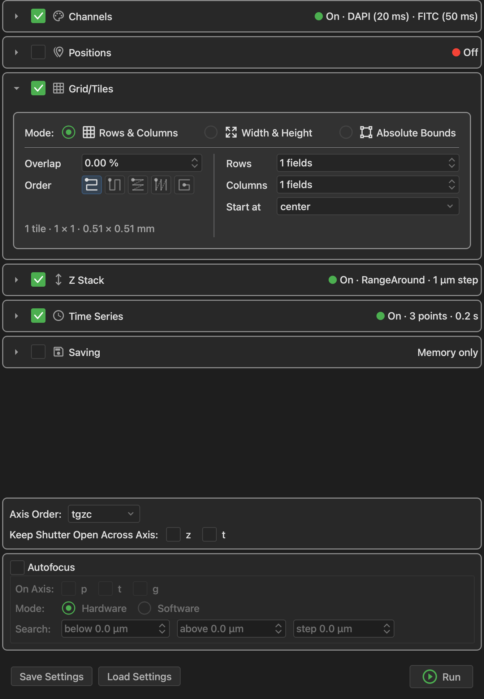

# Acquiring images

Everything here happens on the **Acquire** tab.

## Snap and Live

The **Snap** (camera) and **Live** (video camera) buttons are at the top left.  Both use
the selected channel with its settings from the [Channels panel](#channels).

While Live runs, changes to the selected channel's settings apply straight away, and so
does selecting another channel.

## Channels

{ width="520" loading=lazy }

Each row is a preset of your channel group.  The panel remembers these settings for each
channel:

- **Exposure [ms]:** the camera's exposure time.
- **Light Source** and **Intensity:** a device property to set along with this channel,
  and its value.  Use this for a laser or LED whose power isn't part of the preset, so
  you can change it here without editing the preset.

The app can't tell which property controls your light, so **Light Source** lists every
numeric property that has a range, and you pick the right one.  The intensity is in that
property's own units.

Click the circle at the left of a row to select that channel on the microscope.

These are the settings a channel starts with when you add it to an acquisition.

| Control | What it does |
| --- | --- |
| **Core Channel** | Which configuration group holds your channels.  Normally set once, when you [define the channel group](microscope.md#groups-and-presets). |
| **Light Source** checkbox | Shows or hides the Light Source and Intensity columns.  Leave it checked if your channels use a light source. |
| Save icon | Writes each channel's exposure and light source into a `.cfg` file, so they're restored whenever that file is loaded. |

## Moving the stage

Open the **Stages** panel from the toolbar.

{ width="480" loading=lazy }

Click an arrow to move by the **Step** size, and a **STOP** sign to halt.  **Snap** takes
a picture after each move, and **Poll** keeps the displayed position up to date if
something else moves the stage.  The position fields are read-only: right-click one to
type in it.

!!! warning

    A stage moves as soon as you ask it to.  Be careful with large steps, particularly
    on the focus stage.

## Running an acquisition

The **MDA** panel describes what to acquire as a set of sections.  A checked section is
part of the acquisition, and a closed one summarizes its settings on the right.
Anything left unchecked just isn't varied: with only **Z Stack** on, you get one z-stack
of the current channel at the current position.

Click **Run** when you're ready.  It becomes **Pause** and **Cancel** during the run, and
the status bar shows the progress.  Most other panels are locked until the run ends, so
that nothing changes the hardware in the middle of it.

**Save Settings** and **Load Settings** keep a whole setup in a file, for an experiment
you repeat.

### Channels section

Click the green **+** to add a channel.  It starts with the settings from the
[Channels panel](#channels), and editing one here updates the panel as well.

| Checkbox | What it does |
| --- | --- |
| **Channel Control** | Lets the circle in the first column select the microscope's channel.  Uncheck it if this table should only plan the acquisition. |
| **Advanced** | Adds a **Z Offset** per channel, and **Do Stack** and **Acquire Every**, to take a channel only in some z-stacks or at some time points. |
| **Light Source** | Includes the Light Source and Intensity columns.  While it's unchecked, the acquisition doesn't set them. |

### Positions section

{ width="520" loading=lazy }

Acquire at several places on the sample.  Click the green **+** to add the stage's current
position as a row, and repeat for each place you want.

- **Move Stage to Selected Point** moves the stage when you select a row, to check a
  position.
- **Include Z** also stores each position's focus.  Use this if your sample isn't flat.
- **Save...** and **Load...** keep a list of positions in a file.
- The **Grid** column sets up [tiles](#tiling-a-larger-area) at one position.

#### Well plates

Click **Well Plate...** to open a wizard, in which you choose a plate type, select the
wells, say how to image each one, and calibrate the plate against your stage.  The
result fills the positions table.  **Make Editable** then turns those into ordinary rows,
if you need to adjust them.

### Finding positions with the Stage Explorer

The **Stage Explorer** panel builds a map of your sample from the images you take as you
move around.  Draw regions on the map with its **Rectangle** and **Polygon** tools, then
use **Send to MDA** to add them to the positions table.

It needs a [pixel size](microscope.md#pixel-sizes) to place the images, and says so if
there isn't one.

### Tiling a larger area

{ width="520" loading=lazy }

The **Grid/Tiles** section images an area larger than one field of view, in overlapping
tiles.  Choose how to define it:

| Mode | Use it when |
| --- | --- |
| **Rows & Columns** | You know how many tiles you want, around the current position. |
| **Width & Height** | You know how large an area you want, in mm. |
| **Absolute Bounds** | You want to mark the edges by moving the stage there. |

For **Absolute Bounds**, move the stage to an edge of your area and click that row's
*Mark* button, then do the same for the others.  **Bounds by** switches between marking
the four edges and marking corners.  Next to each *Mark* button is one that moves the
stage back there.

In every mode, **Overlap** is how much neighboring tiles share, **Order** is the path the
stage takes, and the line at the bottom of the section tells you how many tiles you'll
get and how large an area they cover.

A grid needs a [pixel size](microscope.md#pixel-sizes) to work out where the tiles go.
The app warns you before you run one without it.

### Z Stack section

Choose how to define the range:

| Mode | Use it when |
| --- | --- |
| **Symmetric** | You want a range centered on the current focus. |
| **Asymmetric** | You want different distances above and below the current focus. |
| **Top & Bottom** | You want to mark the top and bottom by focusing on them. |

In **Symmetric** mode, set the total **Range**.  Then set the **Step size** or the number
of **Slices**, and the app works out the other one.  **Direction** sets whether to go from
the bottom up or from the top down.

!!! note

    The range starts at 0, which gives no z-stack, so set it first.

### Time Series section

Click the green **+** to add a row.  Set the **Interval** between time points, and either
how many **Loops** to take or for what **Duration**.  A flag marks which of those two you're
setting: click the other's heading to switch.  An interval of `0` goes as fast as the
hardware allows.  Add more rows to run several phases one after another, for example fast
at first and slower afterwards.

### Saving

Check **Saving** to write images to disk as they arrive.  This is what you want for real
data: if something goes wrong halfway through, you keep what was acquired.

Choose a **Directory**, a **Filename** and a format:

| Format | What it is |
| --- | --- |
| **ome-tiff** | The most widely readable format.  With several positions, **Tiff Mode** sets how the files relate to each other.  Hover over each choice for what it means. |
| **ome-zarr** | A chunked format that suits very large data. |

If **Saving** is off, the summary says **Memory only**.  The images are held in RAM, or
spill to disk as set in [Preferences](interface.md#preferences), and they're lost when
you close the app unless you
[save them from the viewer](viewing.md#saving-from-the-viewer).

### Axis order and shutter

**Axis Order** sets the order of the loops, from slowest to fastest.  For example, `tpzc`
means: for each time point, visit each position, take each z slice, and take every channel
at that slice.  `tpcz` would instead take a whole z-stack in one channel before moving on
to the next.

**Keep Shutter Open Across Axis** leaves the shutter open during a z-stack (`z`) or
between time points (`t`), which is faster and reduces wear, but exposes your sample for
longer.

### Autofocus

Check **Autofocus** to refocus during the run.

- **On Axis** sets when: at every stage position (`p`, the usual choice), at every time
  point (`t`), or at every grid tile (`g`).
- **Hardware** uses a focus device such as a Nikon PFS or Zeiss Definite Focus.  It's fast
  and doesn't expose your sample.  **Search** sets how far to look for a lock if it's lost.
- **Software** takes a short z-stack and moves to the sharpest image.  It needs no special
  hardware and focuses on the sample itself, but it costs time and light.  **Method**
  selects how, and the button next to it sets how far to search and which channel to use.

Hover over any of these controls for more detail.

## Closing the app

If an acquisition is running, the app asks before cancelling it.  If you have unsaved
changes to your configuration, it offers to save them.
