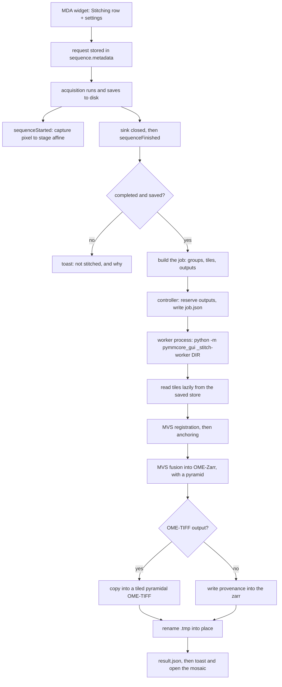

# How stitching works

A grid acquisition saves each field of view as a separate tile. Stitching
turns those tiles into one mosaic: it places every tile where the stage says
it was, refines those positions from the image content where neighbouring
tiles overlap, and blends the overlaps into a single image saved next to the
acquisition.

The heavy lifting is done by
[multiview-stitcher](https://github.com/multiview-stitcher/multiview-stitcher)
(MVS from here on). This repository adds everything around it: which tiles
form a mosaic, where each tile sits on the stage, a worker process to run it
in, the queue, progress and cleanup, and the GUI.

Stitching is **optional**. It needs the `stitching` extra:

```bash
pip install 'pymmcore-gui[stitching]'   # multiview-stitcher>=0.1.63,<0.2
```

Without it, every stitching control is hidden. MVS is pre-alpha, so the range
is capped and widened deliberately after testing. It is **not** in the
bundled app (§10).

<!-- markdownlint-disable MD013 -->
| Where | What |
| --- | --- |
| `multiview-stitcher` | Registration (phase correlation, global resolution) and fusion |
| `_stitching/` (this repo) | Grouping, placement, worker, queue, OME-TIFF output |
| `widgets/` (this repo) | The Saving-section option, the settings dialog, the status bar |
<!-- markdownlint-enable MD013 -->

## 1. End-to-end flow



The same job can also start from a reopened acquisition ("Stitch…") or from
an existing mosaic ("Re-stitch…"); see §8.

## 2. How multiview-stitcher works

MVS treats every tile as a *view*: an image with physical pixel spacing and
one or more named affine transforms that map it into a common world space.
This repo builds each view with `si_utils.get_sim_from_array` and gives it a
transform named `stage`, the placement from the stage position (§4).
Registration then adds a transform named `registered`: the `stage` transform
with a correction composed on top of it. Fusion renders the views through
whichever transform it is given.

### 2.1 Registration

Registration finds, for every tile, a small correction to its stage
placement. It runs in three steps.

1. **Which pairs to compare.** MVS builds a graph whose nodes are tiles and
   whose edges are pairs that overlap under the `stage` placement. This repo
   prunes it with `keep_axis_aligned`: only neighbours along the tile axes are
   kept, not diagonal ones. On a regular grid the diagonals overlap only in a
   corner, too small to measure reliably.
2. **Pairwise registration.** For each remaining pair, MVS cuts out the
   region where the two tiles overlap and registers one against the other by
   **phase correlation** (`skimage.registration.phase_cross_correlation`).
   That compares the two images in the Fourier domain and finds the shift
   that best lines them up, to a tenth of a pixel in 2D. Phase correlation
   has an inherent ambiguity (a shift and its wrapped-around counterparts
   look the same), so MVS tries the candidates and keeps the one that fits
   the overlap best. The result is a **translation**. Each pair also gets a
   **quality** score: the Spearman (rank) correlation of the two overlap
   regions after the shift, 1 for identical content and around 0 for
   unrelated content.
3. **Global resolution.** Pairwise shifts rarely agree perfectly around a
   loop of tiles. MVS solves for one correction per tile that best satisfies
   all of them at once: `global_optimization` up to 100 tiles,
   `linear_two_pass` above that (about twice as fast on large grids, with
   outlier pruning). Since phase correlation only produces shifts, the
   corrections are translations either way.

**Quality filter.** With "Reject poor matches", pairs whose quality is below
the threshold are dropped *before* global resolution. A pair over a blank
region correlates poorly and would otherwise pull its tiles anywhere; without
it, those tiles keep their stage positions relative to the rest.

**Binning.** Registration runs on a binned copy of each overlap. It is
faster and usually as accurate; auto binning picks the smallest of 1, 2, 4
or 8 that brings the longest tile side to at most 1024 pixels.

### 2.2 Fusion

Fusion creates the output grid, aligned with the stage axes, at the
acquisition's pixel size, and computes it **block by block**. For each block
it resamples every view that touches it through the chosen transform, then
combines them:

<!-- markdownlint-disable MD013 -->
| Blending | MVS function | Result where tiles overlap |
| --- | --- | --- |
| Smooth (default) | `weighted_average_fusion` | Weights fall smoothly to zero near each tile's edge, so seams disappear |
| Maximum | `max_fusion` | The brighter pixel: no averaging, seams can show |
| Average | `simple_average_fusion` | Plain mean: shading differences show as steps |
<!-- markdownlint-enable MD013 -->

The **blend width** sets how far in from a tile's edge its smooth weight
ramps up. Auto uses MVS's default of 10 µm in X/Y and 3 µm in Z.

Blocks are written straight into an OME-Zarr (NGFF 0.4), and MVS then writes
the lower-resolution pyramid levels. Fusion has no progress callback; the
engine wraps MVS's block batching (`misc_utils.ndindex_batches`) to count
blocks for the progress bar.

## 3. What gets stitched

`plan_groups(sequence)` (`_stitching/_inputs.py`) decides which tiles form
which mosaic, from the `MDASequence` alone:

| Sequence | Mosaics |
| --- | --- |
| Global grid, no stage positions | 1 |
| Global relative grid × N stage positions | 1 per position |
| Per-position sub-sequence grids | 1 per position that has a grid |
| Well plate whose wells have a grid or coverage | 1 per well, named after it |
| Random points, a 1×1 grid, one field per well | none |

Each tile records its index along the saved store's position axis. That
index must match how ome-writers flattens (stage position, grid point) into
one axis, including grid-first axis orders. A test compares `plan_groups`
with `ome_writers._useq._build_positions` to keep the two in step.

A reader can still list positions in another order. A directory of
independent per-position OME-TIFFs comes back in filename order
(`_r000_c000`, `_r000_c001`, …), which reverses every other row of a snake
grid. So when reading tiles, each one is matched to the saved position whose
recorded stage position is nearest (`locate_tiles`, using
`OMETiffWrapper.stage_positions`). The planned index is kept when positions
aren't recorded or a match isn't unambiguous (within half the tile spacing).

Several mosaics from one run are named `<stem>_stitched_<position>`, or
`<stem>_stitched_<well>` for a plate.

## 4. Where each tile goes

Every tile is placed by an affine built from its stage position and the
camera's pixel-to-stage mapping (`_stitching/_geometry.py`).

**The pixel-to-stage mapping** `A` (2×2, µm per pixel) follows
Micro-Manager's convention, the same rule as the Stage Explorer:

- With a pixel calibration (see [PIXEL_CALIBRATION.md](PIXEL_CALIBRATION.md)),
  the calibrated affine is used as is. It already contains the camera's
  rotation and any mirroring relative to the stage.
- Without one, `A` is `diag(±p, ±p)` from the pixel size and the camera's
  `TransposeMirrorX/Y` properties.
- A calibration whose scale is more than 10% off the pixel size is treated as
  stale, as Micro-Manager does.

For a fresh run, `A` is captured at `sequenceStarted` from the core
(`capture_linear_part`, using the Stage Explorer's `AffineState`). For a
reopened acquisition it is rebuilt from the saved summary metadata
(`calibration_from_summary`): pymmcore-plus records the affine only when it is
not the identity, and the mirror flags among the camera's properties. A test
checks the two paths agree for plain, binned, mirrored and rotated cameras.

**Why the rotation matters.** The stage positions are correct, but the
camera's rows are rarely exactly parallel to the stage's X axis. Pasting
untouched tiles at the right centres would leave mismatches at every seam
growing with the distance from the centre: 0.5° on a 2048-pixel tile at
0.65 µm is about 6 µm at the edge. Registration only shifts tiles, so it
cannot remove that; the tile affine rotates each tile into the stage frame
before fusion.

**The tile affine**, in MVS's (z,) y, x order, maps the image centre to the
stage position: `T(centre) · (A / p) · T(−image centre)`. A z-stack adds its
first plane's Z; a descending stack flips the Z axis so planes keep their
physical order.

**Anchoring.** Global resolution keeps no tile fixed, so a whole connected
group of tiles can drift as one. After registration, each group is shifted
so that its mean corrected centre equals its mean stage centre
(`anchor_corrections`). Tiles left without any accepted pair stay exactly at
their stage positions.

## 5. Z-stacks, time-lapses, and fallbacks

- **Z-stacks** register on the **maximum projection** of each tile by
  default. Full 3D registration of a 3×3 grid of 1024² tiles with 20 planes
  takes ~93 s; the projection takes ~1.6 s. It corrects X and Y only; Z stays
  where the stage put it. Fusion is always 3D. Z planes must be evenly
  spaced.
- **Time-lapses** register the first timepoint and reuse its result for
  every timepoint, which assumes the stage repeats its positions. "Every
  timepoint" also corrects drift between tiles over time, at T times the
  cost.
- **No usable overlap.** If every pair is rejected, or no pair overlaps,
  MVS raises `NotEnoughOverlapError`; the engine catches it and places every
  tile by its stage position.
- **Grids without overlap** (0% or less) can't be registered, so the job
  switches to "stage positions only" before it starts, and the Stitching
  checkbox's tooltip says so.

The finished toast reports any fallback, e.g. "3 tiles placed by stage
position, mosaic aligned in 2 groups".

## 6. Settings

The settings are a `StitchSettingsV1` (`_stitching/_models.py`), edited in
the ⚙ dialog next to the Stitching checkbox. A sequence stores them in
`metadata["pymmcore_gui"]["stitching"]` together with whether stitching is
on, so saved MDA files and "Re-use MDA" keep them. Settings accepted in the
dialog also become the defaults of new sequences (`Settings.stitching`).

<!-- markdownlint-disable MD013 -->
| Setting | Default | Effect |
| --- | --- | --- |
| Alignment | Refine with registration | Or "Use stage positions only": no registration at all (§2.1) |
| Registration channel | First channel | Channel whose images are compared |
| Registration binning | Auto | 1, 2, 4 or 8; auto bins to ~1024 px per tile side |
| Register z-stacks on their max projection | On | Off registers in 3D: much slower (§5) |
| Time-lapse | First timepoint only | Or every timepoint (§5) |
| Reject poor matches below | On, 0.2 | Pairs whose quality (Spearman correlation) is below the threshold are dropped |
| Blending | Smooth | Smooth, Maximum or Average (§2.2) |
| Blend width | Auto | Width of the smooth ramp at tile edges, in µm |
| Format | Same as the acquisition | Or OME-Zarr / OME-TIFF (§7) |
| Open the mosaic when done | On | Opens up to 3 mosaics in viewers; the toast lists the rest |
| Worker threads | Auto | Thread budget for everything the worker does; auto is half the CPU cores |
| Low CPU priority | On | The worker runs at a lower priority than the acquisition |
<!-- markdownlint-enable MD013 -->

The first six are the **registration settings** (`REGISTRATION_SETTINGS`): a
re-stitch reuses the earlier registration only if none of them changed (§8).

## 7. Output

A mosaic is saved **next to the acquisition** as `<stem>_stitched.ome.zarr`
or `.ome.tiff`, and never overwrites anything: a taken name gets `-2`, `-3`,
…. Names are reserved when a job is queued, so two queued jobs from the same
acquisition never collide.

- **OME-Zarr** is written directly by fusion.
- **OME-TIFF**: MVS only streams fusion into Zarr, so the mosaic is fused
  into a temporary OME-Zarr first and copied by `zarr_to_ome_tiff`
  (`_stitching/_tiff_output.py`) into one BigTIFF: 512² tiles, the pyramid
  levels as SubIFDs, OME-XML in XYZCT order. The copy reads in bands of at
  most 256 MB. For a 10×10 grid of 2048² tiles it adds ~5 s (980 MB mosaic)
  and briefly needs twice the disk space.
- "Same as the acquisition" counts ome-writers' one-file-per-position layout
  (a directory of OME-TIFFs) as OME-TIFF.

Everything is written to `<output>.tmp` (and `<output>.zarr.tmp` for
OME-TIFF) and renamed into place only when complete, so a cancelled or failed
job never leaves something that looks finished.

**Provenance.** Each mosaic records how it was made, as a `ProvenanceV1`:
source path and fingerprint (sizes and modification times), tiles, settings,
pixel size, `A`, Z step, channel names, the per-tile corrections, what
registration found, and the MVS version. It is stored in the OME-Zarr root
attributes under `pymmcore_gui.stitching`, or in an OME `MapAnnotation` in the
`pymmcore_gui` namespace for OME-TIFF; both readers' `global_metadata` return
it. Re-stitching depends on it.

## 8. The GUI

**Saving section.** `MemoryMDAWidgetBase` adds a "Stitching: ☐ Also save a
stitched mosaic [⚙]" row to the Saving section. It shows only when the
package is installed and `has_mosaic(sequence)` is true, and sits inside the
Saving group box, so it is disabled whenever Saving is off.

**After a run.** `StitchingSession` (`_stitching/_session.py`) watches the
core's MDA runs:

- at `sequenceStarted` it captures `A` if the sequence asks for stitching;
- at `sequenceFinished` (the runner closes the data sink *before* emitting
  it) it reads the sink's path, frame size and finish reason;
- on the GUI thread it builds the job and queues it. A cancelled or failed
  run is skipped with an info toast; a run saved only in memory is skipped
  silently.

**Status bar.** `StitchingStatusButton` shows `Stitching 1/2 · 42 %` while
jobs are queued or running. Clicking it opens a popover with one row per job:
progress bar, phase ("Registering 14/24", "Fusing 120/400", "Writing
pyramid level 1", "Writing OME-TIFF"), and Cancel (Remove for a queued job).

**Toasts.** Done: the mosaic's name, any fallback, whether an earlier
registration was reused, Show in Folder, and Open when the mosaic wasn't
opened automatically. Failed: the reason and Show Log (the worker's log).

**Stitch… / Re-stitch….** Viewers get a stitching button and context-menu
entry:

- a finished run's own viewer, once the run completed and was saved;
- a reopened grid acquisition (placement from its summary metadata);
- a reopened mosaic, as "Re-stitch…": the job is rebuilt from its provenance,
  the dialog starts from its settings, and the result is a new version next
  to it. If the acquisition moved, the user is asked to locate it.

**Reusing a registration.** A re-stitch carries the earlier corrections
(`SavedRegistrationV1`) when no registration setting changed. The **worker**
decides whether to use them: only if the source's fingerprint, ignoring its
path, still matches, so moved data reuse it and changed data are registered
again. Corrections of the wrong number, shape or timepoints, or that are not
finite or invertible, are also discarded.

**Closing the app** while jobs are queued or running asks first: "Keep
working" or "Cancel stitching and quit". Quitting kills the worker, waits for
it to exit, and deletes the partial output.

## 9. The worker process

Stitching never runs in the GUI process. The acquisition runs on a Python
thread there, so in-process stitching would compete with it for the GIL. A
separate process also isolates crashes, makes Cancel immediate, and returns
all its memory when it exits.

**Launching.** The controller runs `python -m pymmcore_gui _stitch-worker
<job dir>` (frozen: `<app> _stitch-worker <job dir>`). `__main__.main` checks
for that argument before importing the CLI or Qt, and a test checks the
worker never loads Qt.

**The job directory** is the only channel; stdio is not used, since a
windowed Windows bundle may have none. Every file is written atomically.

<!-- markdownlint-disable MD013 -->
| File | Written by | Content |
| --- | --- | --- |
| `job.json` | GUI | `StitchJobV1`: source, groups and outputs, settings, `A`, threads, memory cap, the GUI's PID |
| `owner.json` | worker | The worker's PID and start time |
| `progress.json` | worker | Latest `ProgressEvent`, at most every 0.2 s and at each phase change |
| `result.json` / `error.json` | worker | Written last; exit code 0 / 1 |
| `worker.log` | worker | Everything libraries print |
<!-- markdownlint-enable MD013 -->

Job directories live in `<user data dir>/stitch-jobs`
(`PYMM_STITCH_JOBS_DIR` overrides it; the tests do).

**Watchdog.** Every 2 s the worker checks that the GUI (PID and start time)
still runs, and exits with code 3 if not.

**Queue.** `StitchingController` runs one job at a time with `QProcess`,
polls `progress.json` every 250 ms, and moves each job through
queued → starting → running → finished / failed / cancelling → cancelled.
Partial outputs and finished job directories are deleted on a background
thread.

**Cleanup at startup.** Jobs whose worker and GUI are both gone have their
`.tmp` outputs deleted; only paths a job lists are touched, never a pattern in
a user's folder. A failed job keeps its log for 3 days. Each output name is
listed in `job.json` before it is reserved, so even a GUI that died while
queueing a job leaves nothing behind.

## 10. Resources and packaging

**Threads.** One budget, half the CPU cores by default, covers everything the
worker does: pairwise registration and fusion run on the engine's own thread
pools, dask runs synchronously, and math libraries are limited to one thread
(`OMP_NUM_THREADS` and friends), so nothing oversubscribes the budget.

**Memory.** At queue time a cap of 25% of the available RAM is recorded.
Fusion runs as many blocks at once as fit in it: a block holds its float
output plus the planes of every tile it touches, about doubled for MVS's own
intermediates. Tiles touched per block are counted along the stage axes,
where both the blocks and the grid are aligned, so a slightly rotated camera
doesn't change the count.

**Output blocks** are 2048² in 2D and 8×512×512 in 3D. Block size dominates
fusion time: for a 10×10 grid of 2048² tiles read from disk, 1024² blocks
fuse in 75 s, 2048² in 27 s, 4096² in 45 s.

Measured on an M2 Pro, 6 threads, uncompressed data read from disk:

<!-- markdownlint-disable MD013 -->
| Case | Total | Peak worker memory | Placement error |
| --- | ---: | ---: | ---: |
| 10×10, 2048², OME-Zarr, no memory cap | 46 s | 3.3 GB | 0.12 µm |
| same, capped (25% of 6.3 GB free) | 62 s | 2.1 GB | 0.12 µm |
| same, OME-TIFF in and out | 70 s | 2.2 GB | 0.12 µm |
| 3D 3×3, 1024², 20 planes, max projection | 22 s | 0.95 GB | 0.12 µm |
<!-- markdownlint-enable MD013 -->

**Packaging.** The extra adds 34 packages, about 325 MB. CI installs it in
the lint job and on the macOS Python 3.13 leg; elsewhere the tests that need
it are skipped. **The bundled app built from this branch includes stitching**
(`pymmgui-stitching-<OS>`): the bundle workflow installs every extra,
`app/hooks/hook-wasmtime.py` collects the native library wasmtime loads with
ctypes (itkwasm imports it through ngff_zarr), and `app/mmgui.spec` ships the
source of `dask.array.core`, which ngff_zarr reads at import.
`tests/test_bundle.py` stitches an OME-Zarr and an OME-TIFF acquisition with
the bundled executable, as the GUI starts its worker.

## 11. Limits and what is not done

- **Not yet checked on a real microscope**: orientation with real mirrored
  and rotated cameras, real compressed data, acquisition timing and GUI
  responsiveness with a stitch running alongside.
- **Corrections are translations.** Rotation comes only from the
  calibration; a stage whose axes aren't perpendicular is not corrected.
- **Peak memory** can exceed the cap by the registration buffers and the
  process's baseline (~0.5 GB).
- **No "Finish in background & quit"**: closing the app cancels stitching.
- **A narrow name race** remains: if another GUI takes an output name in the
  instant between our choosing and reserving it, and this GUI then dies
  before trying the next name, startup cleanup could remove the other job's
  reservation.

## Source map

<!-- markdownlint-disable MD013 -->
| File | Role |
| --- | --- |
| `_stitching/__init__.py` | `is_available()`, `has_mosaic()`, `can_stitch()` |
| `_stitching/_models.py` | Settings, the request in sequence metadata, job, progress, result, provenance |
| `_stitching/_geometry.py` | Pixel-to-stage rule, tile affines, anchoring, binning, overlap |
| `_stitching/_inputs.py` | `plan_groups`, `build_job`, `build_restitch_job`, `calibration_from_summary`, lazy tile reading |
| `_stitching/_paths.py` | Output naming and temporary-file cleanup |
| `_stitching/_engine.py` | The only module importing MVS: registration, reuse, fusion, provenance |
| `_stitching/_tiff_output.py` | OME-Zarr → tiled pyramidal OME-TIFF |
| `_stitching/_protocol.py` | The job directory and atomic writes |
| `_stitching/_worker.py` | The worker's entry point and watchdog |
| `_stitching/_controller.py` | Queue, `QProcess`, polling, cancel, cleanup |
| `_stitching/_session.py` | Runs → jobs, toasts, opening mosaics |
| `widgets/_mda_widget.py` | The Saving-section row |
| `widgets/_stitching_dialog.py` | The settings dialog |
| `widgets/_stitching_status.py` | Status-bar button and popover |
| `_ndv_viewers.py`, `_array_viewer.py` | "Stitch…" and "Re-stitch…" on viewers |
| `_main_window.py` | The session, dialogs for Stitch/Re-stitch, the close guard |
| `__main__.py` | Dispatches `_stitch-worker` before any GUI import |
<!-- markdownlint-enable MD013 -->

Tests: `tests/test_stitching_*.py`, with synthetic acquisitions from
`tests/_stitch_synth.py` and a fake worker in `tests/_stitch_fakes.py`.
