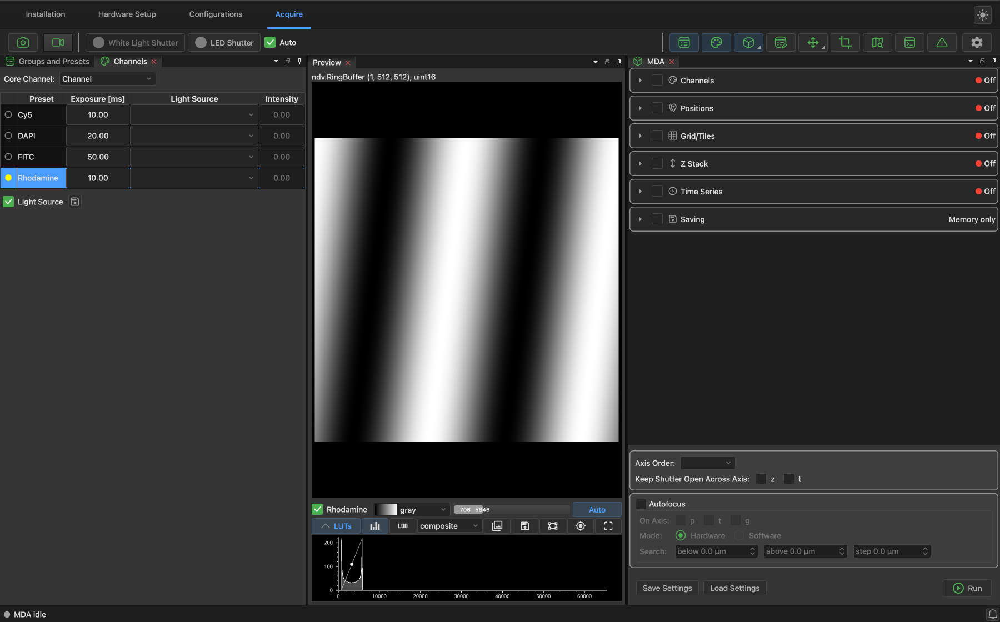
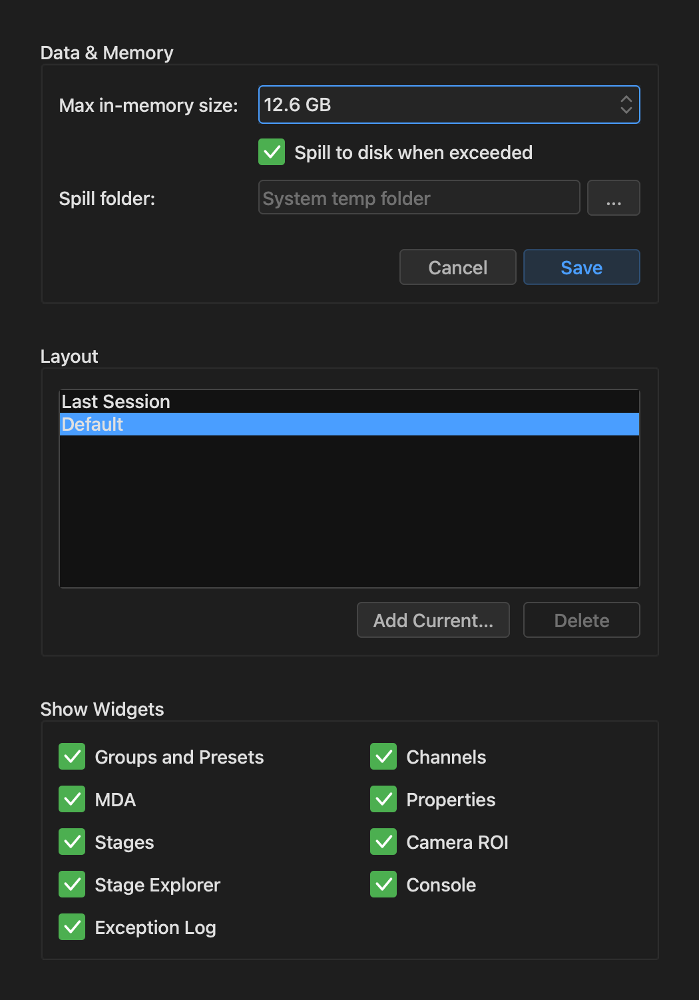

# Finding your way around

## The four tabs

The tabs along the top of the window divide the app by what you're doing:

- **[Installation](microscope.md#installation-tab):** which Micro-Manager device
  adapters are installed.
- **[Hardware Setup](microscope.md#hardware-setup-tab):** which devices your microscope
  has.
- **[Configurations](microscope.md#configurations-tab):** your channels, objectives and
  pixel sizes.
- **[Acquire](acquiring.md):** where you take images.

The app opens on **Acquire** when a configuration loads, on **Hardware Setup** when you
start without one, and on **Installation** if it can't find any device adapters.

## The Acquire toolbar

{ loading=lazy }

On the left are the controls for the camera and shutters:

| Control | What it does |
| --- | --- |
| Camera icon | **Snap** one image. |
| Video camera icon | Start or stop **Live**. |
| Shutter buttons | Open or close each shutter.  There's one per shutter device. |
| **Auto** | Open the shutter only while the camera is exposing, to limit the light on your sample.  Leave this on unless you have a reason not to. |

On the right, each icon shows or hides a *panel*.  Hover over one to see its name:

| Panel | What it's for |
| --- | --- |
| **Groups and Presets** | Switch between presets (objective, camera mode, ...), and open the editor. |
| **Channels** | Each channel's exposure and light source.  See [Channels](acquiring.md#channels). |
| **MDA** | Set up and run [acquisitions](acquiring.md#running-an-acquisition). |
| **Properties** | Read and change any property of any device directly. |
| **Stages** | [Move the XY and Z stages](acquiring.md#moving-the-stage). |
| **Camera ROI** | Image only part of the camera sensor. |
| **Stage Explorer** | [Build a map](acquiring.md#finding-positions-with-the-stage-explorer) of your sample by moving around it. |
| **Console** | An [IPython console](scripting.md#the-console) connected to the running app. |
| **Exception Log** | Errors the app has run into.  Useful when [reporting a problem](troubleshooting.md). |

The gear icon at the end opens [Preferences](#preferences).

!!! tip "Two panels have a second form"

    Right-click the **Stages** button to choose between one control for the default XY
    and Z stages, and separate controls per stage device.  Right-click the **MDA**
    button to choose between the collapsible sections shown in these pages and a layout
    with a navigation bar across the top.

## Arranging the window

Every panel can be moved.  Drag a panel by its tab to dock it somewhere else, or to
stack it with other panels.  Drag the divider between panels to resize them.  Viewer
tabs work the same way, so you can put two images side by side.

Your arrangement comes back the next time you start the app, as the *Last Session*
layout.  You can also save arrangements under a name, for example one for each person or
each experiment:

1. Arrange the window the way you want it.
2. Open **Preferences** (the gear icon).
3. Under **Layout**, click **Add Current...** and give it a name.

Click a layout in that list to switch to it at any time, or choose one in the dialog
when the app starts.  *Default* puts everything back where it started.

!!! tip "Lost a panel?"

    If a toolbar button is missing, check **Show Widgets** in Preferences.  If the
    window is in a mess, click the **Default** layout.

## Preferences

{ width="420" loading=lazy }

- **Data & Memory:** what happens to acquisitions when
  [saving is off](acquiring.md#saving).  **Max in-memory size** is how much RAM a run may
  use, and **Spill to disk when exceeded** lets a bigger run continue on disk, in the
  **Spill folder**.  Without it, the app refuses to start a run that wouldn't fit.  Click
  **Save** to keep changes here.
- **Layout:** switch between, save and delete [layouts](#arranging-the-window).
- **Show Widgets:** which panel buttons appear in the toolbar.  This applies right away.

## Appearance

- The sun or moon icon, at the top right of the window, switches between the dark and
  light themes.
- ++ctrl+shift+equal++ and ++ctrl+shift+minus++ make everything bigger or smaller, and
  ++ctrl+shift+0++ resets it.  On macOS, use ++cmd++ in place of ++ctrl++.

## The status bar

The bar along the bottom of the Acquire tab shows the state of an acquisition: its
progress while it runs, and how it ended.  The bell at the bottom right lists recent
notifications.
