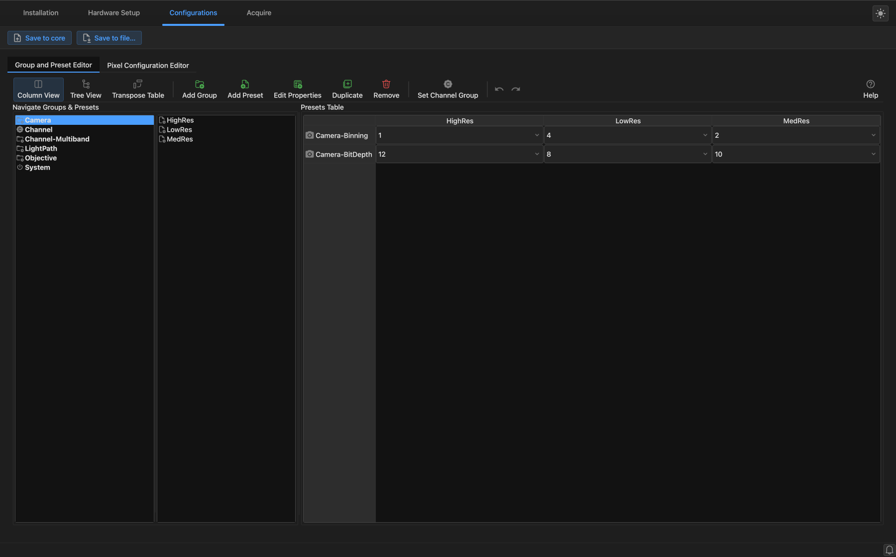
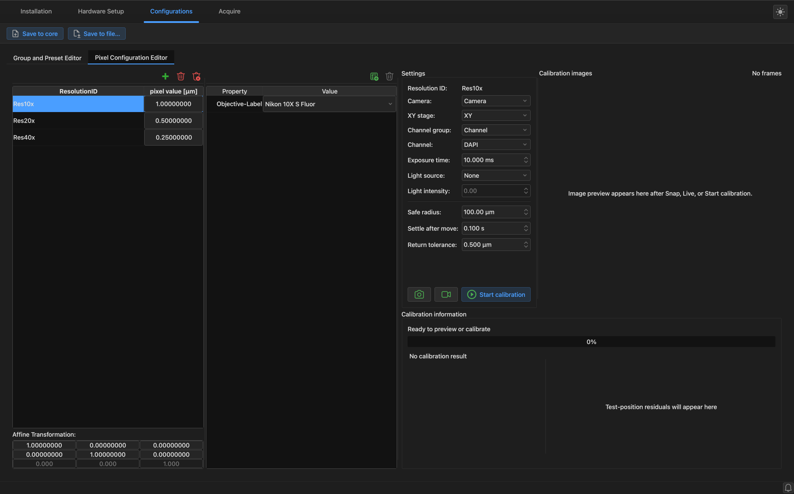

# Setting up your microscope

Three things stand between a fresh install and imaging on your own hardware.  Each one
has a tab, and you go through them from left to right.

| Step | Tab | What you end up with |
| --- | --- | --- |
| 1 | [Installation](#installation-tab) | The device adapters for your hardware |
| 2 | [Hardware Setup](#hardware-setup-tab) | The list of devices your microscope has |
| 3 | [Configurations](#configurations-tab) | Your channels, objectives and pixel sizes |

All of it ends up in one Micro-Manager configuration file (`.cfg`).

!!! tip "Already have a `.cfg` file?"

    If you've used Micro-Manager on this microscope, your configuration file works here
    too.  Choose **Browse...** in the startup dialog to load it, then skip to
    [Channels](acquiring.md#channels).

## Installation tab

{ loading=lazy }

This lists the versions of the Micro-Manager device adapters on your computer.

- **Install** downloads a version.  Unless you know you need a particular one, take the
  one it offers.  On Apple Silicon Macs and Linux this only gets
  [the test adapters](install.md#2-install-the-device-adapters), so you won't find your
  real hardware listed.
- **Set Active** switches to the selected version.  Doing this unloads any devices that
  are loaded, as they belong to the old version.
- **Reveal** shows the selected version's folder, **Uninstall** deletes it, and
  **Refresh** looks again for what's installed.

!!! note "Device interface versions"

    The **Device Interface** column has to match what this version of the app supports,
    or the adapters won't load.  The line below the table shows the version of `pymmcore`
    in use, whose last number but one is what it expects.

!!! warning "Vendor drivers"

    The device adapters only let Micro-Manager talk to your hardware's own software.
    Most cameras and some other devices also need the vendor's driver or SDK, which
    you install separately.  See the
    [Micro-Manager device support list](https://micro-manager.org/Device_Support) for
    what each one needs.

## Hardware Setup tab

{ loading=lazy }

This is where you say what's attached to the computer.  It replaces Micro-Manager's
Hardware Configuration Wizard.

1. Click **New** to start from nothing, or **Load...** to edit an existing `.cfg`.
2. Under **Available Devices**, find a device.  Use the filter box or the type dropdown.
   Devices are listed by the adapter that drives them, not always by your hardware's
   model name.
3. Click it, then click **Add Device** in the **Device Setup** area.  Fill in any settings
   it asks for, typically the serial port, and click **Finish**.
4. If it's a *hub* (a controller with several devices attached), you're asked which
   devices it provides.
5. Repeat for each device.  You can click an installed device to change its settings or
   rename it, and **Remove** takes one out.
6. Under **Default Devices**, say which device plays which role: which camera, shutter,
   XY stage and focus stage the app should use.
7. Click **Save...** to write the `.cfg` file.

!!! warning "Save your work"

    Your devices are loaded as you add them, but they aren't in a file until you click
    **Save...**.  The app warns you if you try to quit or start over with unsaved
    changes.

To get a feel for what a complete setup looks like, load the demo configuration and
click through its devices.

## Configurations tab

Devices have many settings.  This tab is where you give useful combinations a name, so
that you can select "DAPI" rather than setting a filter wheel, a dichroic and a shutter.

It has two buttons at the top, whichever editor you're using:

- **Save to core** applies your edits to the running session only.
- **Save to file...** applies them and also writes them to a `.cfg` file.

If you leave the tab with unsaved edits, the app asks what to do with them.

### Groups and presets

{ loading=lazy }

A **preset** is a named set of device settings, such as the positions of the filter
wheels for DAPI.  A **group** is a set of presets you choose between, such as "Channel",
containing DAPI, FITC and Cy5.

To define one:

1. Click **Add Group**, and name it (for example, `Channel`).
2. Click **Add Preset**, and name it (for example, `DAPI`).
3. Click **Edit Properties**, and choose the device properties this group controls.
4. Set their values for this preset in the **Presets Table** on the right.
5. Add more presets.  **Duplicate** copies one, for when another is similar.

**You need a channel group.**  Select the group that holds your channels and click **Set
Channel Group**, so that the app knows these are the presets to offer as channels.

!!! tip

    The **Help** button in this editor opens a guide to groups and presets.

Other groups are often useful as well, such as `Objective` for your lenses or `Camera`
for binning and bit depth.  You switch between them in the **Groups and Presets** panel
on the Acquire tab.

### Pixel sizes

{ loading=lazy }

The **Pixel Configuration Editor** tells the app how big a camera pixel is on the sample
with each objective.  The [grid](acquiring.md#tiling-a-larger-area) and the
[Stage Explorer](acquiring.md#finding-positions-with-the-stage-explorer) need this to
place images correctly.

1. Click the green **+** to add a resolution, one per objective.
2. In the middle table, add the property that selects that objective, and set its value.
3. Enter the **pixel value** in µm, if you know it.

If you don't know it, the app can measure it, which also finds any rotation between your
camera and stage.  You need a sample with visible detail, in focus.

1. Under **Settings**, choose the camera, stage and channel, and a suitable exposure.
   Use the camera and video camera icons to check the image.
2. Set **Safe radius** to the furthest the stage may travel without hitting anything.
3. Click **Start calibration**.  The stage moves on its own, and the images and results
   appear on the right.
4. Check the result under **Calibration information**.  If it passes its consistency
   check, it's applied to the resolution automatically.  If not, it tells you why, and
   you can review the measurements and choose **Apply anyway**.
5. Click **Save to file...** to keep the result.
