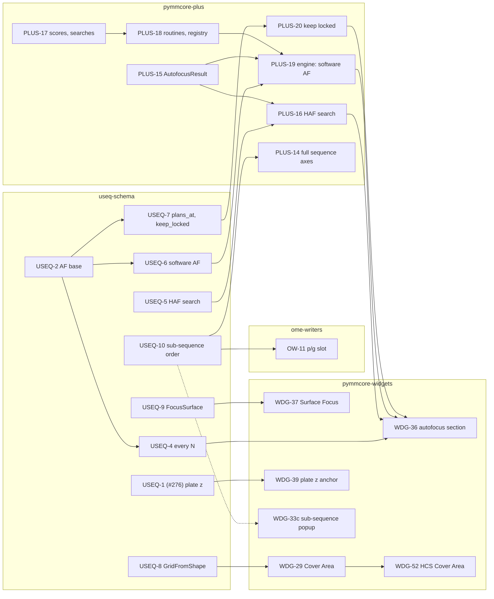

# Upstreaming the `cite` forks

pymmcore-gui runs on forks of five packages (`fdrgsp/<repo>`, branch `cite`).
These plans split what the forks add into small upstream PRs, one file per
repository. pymmcore-gui itself has no plan: its architecture is its own.

<!-- markdownlint-disable MD013 -->
| Repository | Upstream | Fork ahead by | Plan |
| --- | --- | --- | --- |
| useq-schema | `pymmcore-plus/useq-schema` | 24 commits, +2.8k / −0.3k | [USEQ_SCHEMA.md](USEQ_SCHEMA.md) |
| pymmcore-plus | `pymmcore-plus/pymmcore-plus` | 64 commits, +6.8k / −0.2k | [PYMMCORE_PLUS.md](PYMMCORE_PLUS.md) |
| ome-writers | `pymmcore-plus/ome-writers` | 33 commits, +2.1k / −0.4k | [OME_WRITERS.md](OME_WRITERS.md) |
| ndv | `pyapp-kit/ndv` | 28 commits, +1.2k / −0.2k | [NDV.md](NDV.md) |
| pymmcore-widgets | `pymmcore-plus/pymmcore-widgets` | 373 commits, +34k / −3.2k | [PYMMCORE_WIDGETS.md](PYMMCORE_WIDGETS.md) |
<!-- markdownlint-enable MD013 -->

Counts are
`git diff --stat $(git merge-base upstream/main origin/cite) origin/cite`
on 2026-11-26, tests and fork-only files included.

## Conventions

- **IDs**: `USEQ-n`, `PLUS-n`, `OW-n`, `NDV-n`, `WDG-n`. A letter suffix
  (`PLUS-18a`, `PLUS-18b`) is one PR of a split: open them in letter order.
- **Size** counts changed source lines, tests excluded: **S** up to about 150,
  **M** up to about 400, **L** above that. Most large changes are already split
  into lettered PRs; each remaining L entry says where to split it.
- **From** lists the fork commits that hold the change. Port the *final* code
  on `cite`, not the commits: many were reworked by later ones.
- **Needs**: merged first. Across repositories, also *released*: upstream CI
  installs the other packages from PyPI, so the dependent PR goes green only
  after that release, and it bumps the minimum version.
- **Pairs with**: the PR in another repository that delivers the other half of
  a feature. Link the two in their descriptions.
- Every PR brings the fork's tests for what it ports, trimmed to that scope.

## Cross-repository chains

Seven features need PRs in more than one repository. Within a chain, merge from
left to right.

<!-- markdownlint-disable MD013 -->
| Chain | PRs, in merge order |
| --- | --- |
| Software autofocus | USEQ-2 → USEQ-6 → PLUS-15 → PLUS-17a/b → PLUS-18a/b/c → PLUS-19 → WDG-36a → WDG-36d-1/2/3 |
| Hardware autofocus options | USEQ-2 → USEQ-4 / USEQ-5 → PLUS-16 → WDG-36b / WDG-36c |
| Keep the autofocus locked | USEQ-7a/b → PLUS-20a/b/c/d → WDG-36e |
| Focus surface | USEQ-9a → USEQ-9b → WDG-37a/b |
| Cover Area tiling | USEQ-8a/b → WDG-29 → WDG-52 |
| Sub-sequence axis order | USEQ-10 → PLUS-14, OW-11 (one test case), WDG-33c (grid-only popup) |
| Plate positions without z | USEQ-1 (upstream #276) → WDG-39 |
<!-- markdownlint-enable MD013 -->

The viewer and data-saving features (PLUS-10/11/12, OW-6/10, NDV-10/11) have no
partner PR upstream: their consumer is pymmcore-gui.

## Overlap with other people's open upstream PRs

Check these before opening the PRs that overlap, and comment on them first.

<!-- markdownlint-disable MD013 -->
| Upstream PR | Overlaps | What to do |
| --- | --- | --- |
| useq-schema #276 (alandolt), plate positions get z=0 | USEQ-1 | Same fix as the fork's `0050879`: review #276, don't duplicate it |
| pymmcore-widgets #553 (gcharvin), software AF in MDAWidget | WDG-36d, USEQ-6, PLUS-19 | Different split (engine code in widgets, settings in metadata). Comment with the useq + plus design before WDG-36 |
| pymmcore-widgets #542 (tlambert03), Z plan widget refactor | WDG-30, WDG-31 | Build the Z editor PRs on top of it, or fold WDG-30 into it |
| pymmcore-widgets #546 (tlambert03), console highlighting and filters | WDG-11 | Rebase the log fix on it if it lands first |
| pymmcore-widgets #561 (gselzer), `ShuttersWidget` → `ShutterWidget` | WDG-13 | Open WDG-13 after it |
| pymmcore-widgets #564 (alandolt), keep positions when the FOV changes | fork commit `321e6c43` | The fork already follows it: review #564, no PR of ours |
| pymmcore-plus #630 (ieivanov) and #618 (marktsuchida), CoreLog and log rotation | PLUS-9 | Same Windows problem, other fixes: agree on one |
| pymmcore-plus #609 (tlambert03), UniMMCore refactor; #637 (hinderling) | PLUS-21 to PLUS-24 | Wait for #609, then rebase |
| ome-writers #150 (tlambert03), raise TIFF writer-thread errors | OW-8 | Land #150 first, rebase the writer pool on it |
| ome-writers #139 (aaronkanzer, closed unmerged), frame counts in stubs | OW-2 | Credit it in OW-2 |
| ndv #285 (kephale), canvas and camera APIs | NDV-11 | Agree on the public API with it |
<!-- markdownlint-enable MD013 -->

## Your own open upstream PRs

<!-- markdownlint-disable MD013 -->
| PR | State | Suggestion |
| --- | --- | --- |
| pymmcore-widgets #529, save names (`get_next_available_path`) | open, on `main` | WDG-54: refresh with the fork's version, on top of the merged #568 |
| pymmcore-widgets #531, flip menu in StageViewer | open, on `main` | WDG-57: refresh with the fork's code and tests |
| pymmcore-widgets #482, calibrating plates with fewer than 3 wells | open, on `main` | WDG-58: refresh with the fork's code and tests |
| pymmcore-widgets #522, ConfigWizard (WIP) | open, on `main` | WDG-18: refresh with the fork's `hcwizard/` |
| useq-schema #147, time interval exceeded (WIP) | open | Not in these plans: finish or close |
<!-- markdownlint-enable MD013 -->

## What stays in the forks

- `AGENTS.md`, `CLAUDE.md`, the `[tool.uv.sources]` pins to other forks, and CI
  edits that limit coverage uploads to upstream.
- ome-writers' `requires-python >=3.11`: it is only there for the useq fork.
- pymmcore-plus `a1b89b9` (Python 3.10 support): upstream now requires 3.11.
- pymmcore-plus smart microscopy: already removed from `cite` (`60f1165`).

## Suggested order

1. **Independent fixes, in parallel**: USEQ-1, PLUS-1 to PLUS-8, OW-1 to OW-4,
   NDV-1 to NDV-6, WDG-1 to WDG-14, your four open widget PRs (WDG-18, 54, 57,
   58), and the other `fix` PRs of pymmcore-widgets.
2. **useq-schema features**: USEQ-2 to USEQ-9, then ask for a useq-schema
   release.
3. **pymmcore-plus and ome-writers features**: PLUS-10 to PLUS-20 and OW-5 to
   OW-12, then releases.
4. **pymmcore-widgets features** that need those releases (WDG-29, 36, 37, 39,
   52).
5. **pymmcore-widgets visible changes** (WDG-28, 30, 40a to 40d, 42), one per
   PR with screenshots, all on `main`, released together in one minor
   version.
6. **Open an issue first**: USEQ-10, NDV-4b, NDV-7, NDV-8, WDG-10, WDG-25,
   WDG-33c, WDG-42, WDG-56. These change behavior or looks people rely on.
