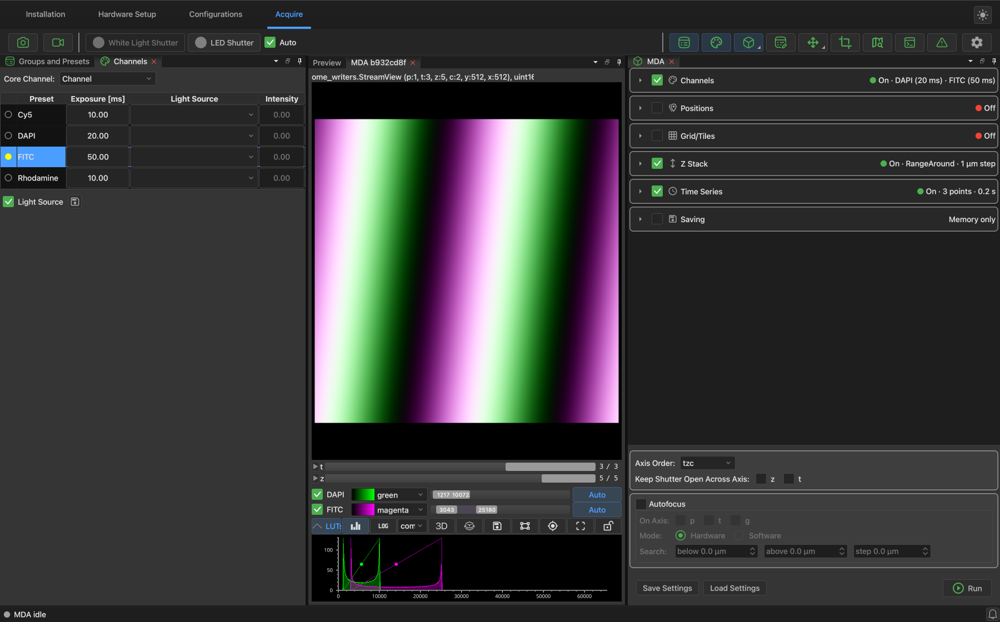

# Viewing and saving images

Images open as tabs in the middle of the Acquire page:

- **Preview** shows Snap and Live.
- **MDA ...** tabs each show one acquisition, as it runs and afterwards.
- A tab for each [earlier snap](#getting-back-an-earlier-snap) or
  [saved dataset](#opening-saved-data) that you open.

Right-click a tab to close it or all the others.  You can drag a tab to place images side
by side.

{ loading=lazy }

## Moving around

Scroll to zoom, and drag to pan.  If you've lost track of the image, click the button with
four corners, in the row below it, to fit it back into the view.

The sliders below the image (**t**, **z**, and so on) move through the data's dimensions.

## Channels and contrast

Each channel has a row below the sliders:

- The checkbox shows or hides it.
- The dropdown sets its color.
- The bar sets its contrast range, which you can drag, and **Auto** sets it automatically
  from the image.

The **LUTs** button shows or hides these rows.  The histogram button displays the
distribution of pixel values, which you can also use to set the contrast, and **LOG** puts
it on a log scale.  The app remembers each channel's color from one acquisition to the
next.

## Other controls

| Button | What it does |
| --- | --- |
| Mode dropdown | **composite** overlays the channels, and other modes show one at a time. |
| **3D** | Shows a z-stack as a volume. |
| Cube icon | Cycles through the orthogonal views (XY, XZ, YZ). |
| Square icon | Draws a region of interest on the image. |
| Target icon | Marks the center of the field of view. |
| Lock icon | During an acquisition, stops the sliders from following the newest image. |
| Save icon | [Saves](#saving-from-the-viewer) what the viewer holds. |

## Getting back an earlier snap

Each snap replaces the last one in the Preview, but the app keeps the last ten.  Click the
image-stack icon below the Preview to list them:

{ width="300" loading=lazy }

Double-click one, or select it and press ++enter++, to open it in its own tab.  The tab is
named after the settings it was taken with: for example `DAPI · 20 ms · I=55 · 11:14:56`,
where `I` is the [intensity](acquiring.md#channels) if the channel uses a light source.

These snaps are only in memory, so [save](#saving-from-the-viewer) any you want to keep.

## Saving from the viewer

Click the save icon below the image to write what a viewer holds to a file.  This is how
you keep an acquisition that ran with [saving off](acquiring.md#saving).  You can also use
it to convert data you already saved to another format.

Choose **OME-TIFF** or **OME-Zarr** as the file type.  The metadata from the acquisition
is included.

The tab is then renamed after the file.

## Opening saved data

Drag an OME-TIFF file, or an OME-TIFF or OME-Zarr folder saved by this app, onto the
window.  It opens in a new tab.

## Repeating an acquisition

Right-click the image of an acquisition, or of data you opened, and choose **Re-use
MDA...** to load its settings into the MDA panel.  Your current settings there are
replaced, so the app asks first.
